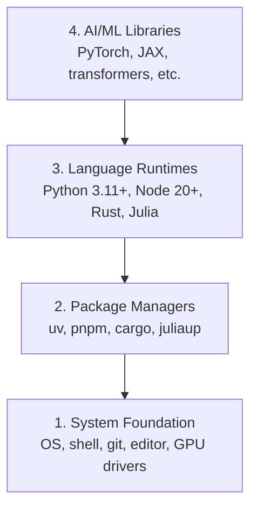

# Ambiente de desenvolvimento

> Suas ferramentas influenciam a maneira como você pensa. Configure-as bem desde o início.

**Type:** Build
**Languages:** Python, Node.js, Rust
**Prerequisites:** None
**Time:** ~45 minutes

## Objetivos de aprendizagem

- Instalar Python 3.11+, Node.js 20+ e as ferramentas de Rust desde o início
- Configurar ambientes virtuais e gerenciadores de pacotes para criar ambientes reproduzíveis
- Verificar o acesso à GPU com CUDA/MPS e executar uma operação de teste com tensores
- Entender as quatro camadas do ambiente: sistema, gerenciadores de pacotes, ambientes de execução e bibliotecas de IA

## O problema

Você vai estudar engenharia de IA ao longo de mais de 500 aulas, usando Python, TypeScript, Rust e Julia. Se o ambiente estiver mal configurado, cada aula vira uma batalha com as ferramentas em vez de uma oportunidade de aprender.

Muita gente pula a configuração inicial e depois passa horas investigando erros de importação, conflitos de versões e drivers CUDA ausentes. Vamos configurar tudo corretamente uma vez.

## O conceito

Um ambiente de engenharia de IA tem quatro camadas:



A instalação começa pela base: cada camada depende da que está abaixo dela.

```figure
s0-env-stack
```

## Construa

### Etapa 1: base do sistema

Confira seu sistema e instale as ferramentas básicas.

```bash
# macOS
xcode-select --install
brew install git curl wget

# Ubuntu/Debian
sudo apt update && sudo apt install -y build-essential git curl wget unzip

# Windows (use WSL2)
wsl --install -d Ubuntu-24.04
```

### Etapa 2: Python com uv

Usaremos `uv`: ele é de 10 a 100 vezes mais rápido que o pip e gerencia ambientes virtuais automaticamente.

```bash
curl -LsSf https://astral.sh/uv/install.sh | sh

uv python install 3.12

uv venv
source .venv/bin/activate  # or .venv\Scripts\activate on Windows

uv pip install numpy matplotlib jupyter
```

Confira a instalação:

```python
import sys
print(f"Python {sys.version}")

import numpy as np
print(f"NumPy {np.__version__}")
a = np.array([1, 2, 3])
print(f"Vector: {a}, dot product with itself: {np.dot(a, a)}")
```

### Etapa 3: Node.js com pnpm

O Node.js será usado nas aulas de TypeScript (agentes, servidores MCP e aplicações web).

```bash
curl -fsSL https://fnm.vercel.app/install | bash
fnm install 22
fnm use 22

npm install -g pnpm

node -e "console.log('Node', process.version)"
```

O instalador do fnm verifica primeiro se o `unzip` está disponível. Se não estiver, encerra com a mensagem `Not installing fnm due to missing dependencies.`. No Linux, ele descompacta um arquivo ZIP; no macOS, instala o fnm pelo Homebrew. O macOS já inclui `unzip`; no Ubuntu, Debian e WSL2, o comando `apt` da etapa 1 instala essa ferramenta. Se você pulou aquela etapa, execute `sudo apt install -y unzip`.

**macOS / Apple Silicon (M1/M2/M3/M4):** Se a instalação parar com `Error: Cannot install under Rosetta 2 in ARM default prefix (/opt/homebrew)`, o terminal está rodando sob Rosetta 2 (`arch` mostra `i386`), enquanto o Homebrew foi instalado para arm64 nativo. Instale o fnm forçando arm64, configure-o no shell e repita os comandos anteriores a partir de `fnm install 22`:

```bash
arch -arm64 brew install fnm
echo 'eval "$(fnm env --use-on-cd)"' >> ~/.zshrc
source ~/.zshrc
```

### Etapa 4: Rust

O Rust será usado nas aulas que exigem alto desempenho (inferência e sistemas).

```bash
curl --proto '=https' --tlsv1.2 -sSf https://sh.rustup.rs | sh

rustc --version
cargo --version
```

### Etapa 5: Julia (opcional)

A Julia será usada em aulas com maior ênfase em matemática.

```bash
curl -fsSL https://install.julialang.org | sh

julia -e 'println("Julia ", VERSION)'
```

### Etapa 6: configure a GPU (se houver)

**NVIDIA (Linux / Windows):**

```bash
nvidia-smi

# Install PyTorch with CUDA
uv pip install torch torchvision torchaudio --index-url https://download.pytorch.org/whl/cu124
```

**macOS / Apple Silicon (M1/M2/M3/M4):** Macs não usam CUDA, e isso é esperado. **Não** passe `--index-url .../cuXXX`: esses pacotes são exclusivos de Linux e Windows, e a instalação falhará no macOS. Instale a versão padrão, que inclui o backend de GPU MPS (Metal) da Apple:

```bash
uv pip install torch torchvision torchaudio
```

Confira o resultado (o código funciona em qualquer plataforma):

```python
import torch
print(f"CUDA available: {torch.cuda.is_available()}")           # False on macOS — expected
print(f"MPS available:  {torch.backends.mps.is_available()}")   # True on Apple Silicon
if torch.cuda.is_available():
    print(f"GPU: {torch.cuda.get_device_name(0)}")
```

Não tem GPU? Tudo bem. A maioria das aulas funciona com CPU. Nas aulas com treinamento mais pesado, você pode usar o Google Colab ou GPUs na nuvem.

### Etapa 7: verifique o percurso que deseja iniciar

Execute todos os comandos desta aula a partir da raiz do repositório, a pasta que contém `README.md` e `phases/`. A verificação inicial examina apenas o que você precisa para começar o percurso escolhido. As ferramentas de aulas posteriores são ignoradas por padrão, para que você receba uma resposta clara em vez de uma longa lista de alertas.

Para iniciar a sequência completa para iniciantes:

```bash
python3 phases/00-setup-and-tooling/01-dev-environment/code/verify.py --route beginner
```

Ou verifique apenas o percurso desejado:

```bash
python3 phases/00-setup-and-tooling/01-dev-environment/code/verify.py --route ml-foundations
python3 phases/00-setup-and-tooling/01-dev-environment/code/verify.py --route llm-engineering
python3 phases/00-setup-and-tooling/01-dev-environment/code/verify.py --route agents
python3 phases/00-setup-and-tooling/01-dev-environment/code/verify.py --route mcp
python3 phases/00-setup-and-tooling/01-dev-environment/code/verify.py --route agent-skills
python3 phases/00-setup-and-tooling/01-dev-environment/code/verify.py --route certification
```

Acrescente `--show-later` se quiser que a mesma verificação examine ferramentas e dependências opcionais usadas nas aulas posteriores. A ausência de uma ferramenta posterior nunca impede o início do percurso escolhido.

Cada verificação obrigatória que falhar mostra o caminho detectado ou o erro de importação e um comando específico para corrigir o problema. Os percursos de Agent Skills e certificação também exibem verificações manuais do ambiente que hospeda a IA: um script Python não consegue confirmar que esse ambiente reconheceu uma skill nem que o escopo escolhido permite a gravação.

Quando a verificação para iniciantes passa, ela mostra o comando exato da primeira aula executável:

```text
Ready to start Beginner course.
Next: python3 phases/01-math-foundations/01-linear-algebra-intuition/code/vectors.py
```

## Use

Seu ambiente está pronto para iniciar o percurso verificado. Instale outras ferramentas quando as aulas precisarem delas, sem adiar o começo até que toda a infraestrutura esteja pronta. Veja como as linguagens serão usadas ao longo do curso:

| Linguagem | Onde é usada | Gerenciador de pacotes |
|----------|---------|-----------------|
| Python | Fases 1 a 12 (ML, DL, NLP, visão, áudio e LLMs) | uv |
| TypeScript | Fases 13 a 17 (ferramentas, agentes, sistemas multiagentes e infraestrutura) | pnpm |
| Rust | Fases 12 e 15 a 17 (sistemas que exigem alto desempenho) | cargo |
| Julia | Fase 1 (fundamentos matemáticos) | Pkg |

## Entregue

Esta aula produz um script de verificação que qualquer pessoa pode executar para conferir a própria configuração.

Consulte `outputs/prompt-env-check.md` para ver um prompt que ajuda assistentes de IA a diagnosticar problemas no ambiente.

## Exercícios

1. Execute o script de verificação e corrija os problemas encontrados.
2. Crie um ambiente virtual Python para este curso e instale o PyTorch.
3. Escreva um "olá, mundo" nas quatro linguagens e execute cada programa.

### Dicas

**Exercício 1.** Execute `python3 phases/00-setup-and-tooling/01-dev-environment/code/verify.py --route beginner` a partir da raiz do repositório. Corrija a primeira falha antes de investigar a próxima. A tarefa estará concluída quando você executar o script novamente e todas as verificações obrigatórias passarem.

**Exercício 2.** Crie o ambiente virtual com `uv venv` na raiz do repositório e ative-o. Depois instale o PyTorch usando o comando da etapa 6 apropriado para o seu hardware. Execute `python -c "import torch; print(torch.__version__)"` dentro do ambiente. Se uma versão for exibida, a instalação funcionou.

**Exercício 3.** Use os quatro ambientes de execução apresentados em O conceito: Python, TypeScript no Node.js, Rust e Julia. Escreva um arquivo pequeno para cada linguagem e execute-o com `python3`, `npx tsx` (o Node.js não executa diretamente arquivos `.ts`), `cargo run` ou `rustc`, e `julia`. Cada programa deve imprimir sua mensagem e terminar com código 0.
